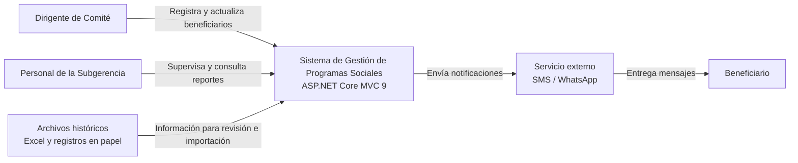

# C1 - Diagrama de Contexto

## 1. Descripción

El diagrama de contexto muestra el Sistema de Gestión de Programas Sociales de Huamanga y su relación con los usuarios y los servicios externos.

Los dirigentes de los comités registran y actualizan la información de los beneficiarios. El personal de la Subgerencia supervisa los registros, revisa alertas y consulta reportes. Los beneficiarios pueden recibir notificaciones relacionadas con los programas sociales.

## 2. Diagrama

## 3. Elementos del diagrama

- **Dirigente de Comité:** registra, actualiza e inactiva beneficiarios y puede trabajar sin conexión cuando la funcionalidad está disponible.
- **Personal de la Subgerencia:** supervisa la información, revisa posibles duplicados y consulta reportes de cobertura.
- **Beneficiario:** persona inscrita en un programa social que puede recibir notificaciones.
- **Sistema:** aplicación encargada de gestionar la información y las operaciones de los programas sociales.
- **Archivos históricos:** hojas de cálculo y registros en papel que sirven como fuentes para revisar o importar información.
- **Servicio SMS / WhatsApp:** servicio externo previsto para enviar notificaciones.

## 4. Alcance

El sistema contempla la gestión de beneficiarios de programas como Vaso de Leche y Comedores Populares. Las integraciones con RENIEC y SISFOH no forman parte de la primera versión documentada.
