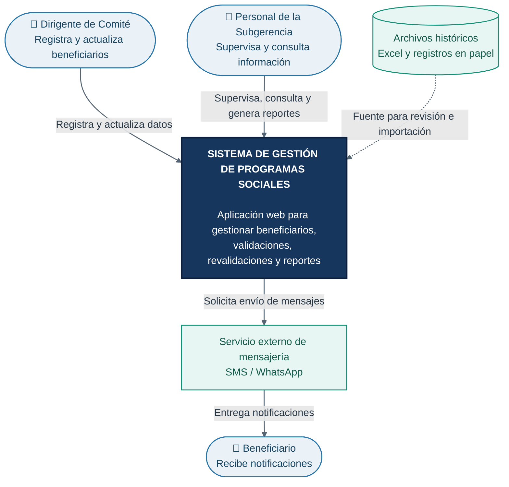

# C1 — Diagrama de Contexto del Sistema

**Proyecto:** Sistema de Gestión de Programas Sociales de Huamanga  
**Modelo:** C4 — Nivel 1: Contexto  
**Propósito:** Identificar los usuarios, el sistema y sus relaciones externas.

## Diagrama de contexto

## Descripción

El sistema centraliza la gestión de beneficiarios de programas sociales, como Vaso de Leche y Comedores Populares. Los dirigentes registran y actualizan información, mientras que el personal de la Subgerencia supervisa los datos y consulta reportes. Los archivos históricos sirven como fuente de información y el servicio externo de mensajería permite contemplar el envío de notificaciones.

**Nota:** las integraciones con RENIEC y SISFOH no se representan porque no forman parte de la primera versión documentada.
