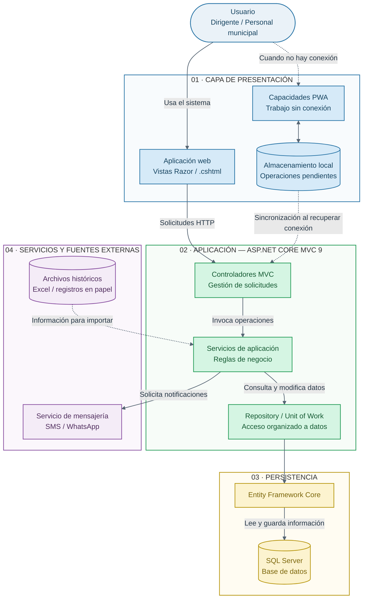

# C2 — Diagrama de Contenedores

**Proyecto:** Sistema de Gestión de Programas Sociales de Huamanga  
**Modelo:** C4 — Nivel 2: Contenedores  
**Propósito:** Mostrar las principales unidades tecnológicas y sus comunicaciones.

## Diagrama de contenedores

## Descripción

La solución se plantea como un monolito modular desarrollado con ASP.NET Core MVC 9 y C#. La interfaz utiliza vistas Razor, los servicios concentran las reglas del negocio y el acceso a datos se organiza mediante Repository y Unit of Work. Entity Framework Core permite la comunicación con SQL Server.

Las capacidades PWA y el almacenamiento local representan el soporte previsto para trabajar sin conexión y sincronizar operaciones pendientes. Su funcionamiento depende de la implementación concreta del proyecto.
