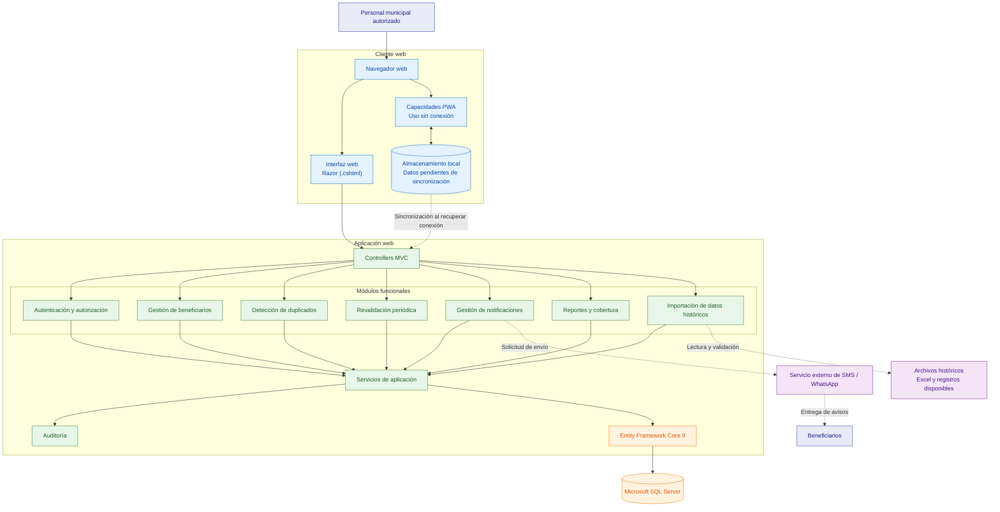

# C2. Diagrama de contenedores

## 1. Objetivo

El diagrama de contenedores representa las principales partes tecnológicas del sistema de gestión de programas sociales, sus responsabilidades y las relaciones entre ellas.

La solución se plantea como un **monolito modular**, desarrollado con ASP.NET Core MVC 9, que utiliza Entity Framework Core 9 para acceder a Microsoft SQL Server.

Los contenedores y componentes representados corresponden a la arquitectura propuesta. Su implementación y despliegue están pendientes de validación.

## 2. Diagrama de contenedores

## 3. Descripción de los contenedores

| Contenedor o elemento | Responsabilidad |
|---|---|
| Cliente web | Permite al personal municipal acceder al sistema mediante un navegador. |
| Interfaz Razor | Presenta formularios, listados y resultados al usuario. |
| Capacidades PWA | Permiten plantear el uso sin conexión y la sincronización posterior. |
| Almacenamiento local | Conserva temporalmente los datos pendientes de sincronización, sujeto a diseño de seguridad. |
| Aplicación ASP.NET Core MVC 9 | Centraliza las solicitudes, reglas de negocio y coordinación de los módulos. |
| Módulos funcionales | Organizan las funciones de autenticación, beneficiarios, duplicados, revalidación, notificaciones, reportes e importación. |
| Servicios de aplicación | Coordinan operaciones y reglas del sistema. |
| Auditoría | Registra las operaciones relevantes para facilitar su seguimiento. |
| Entity Framework Core 9 | Gestiona el acceso a los datos mediante el proveedor compatible con SQL Server. |
| Microsoft SQL Server | Almacena la información persistente del sistema. |
| Servicio externo de mensajería | Representa la posible integración para enviar notificaciones por SMS o WhatsApp. |
| Archivos históricos | Constituyen fuentes de información para importar y validar registros existentes. |

## 4. Relaciones principales

1. El personal municipal accede al sistema desde el navegador web.
2. La interfaz Razor envía las solicitudes a los controladores MVC.
3. Los controladores coordinan las operaciones con los módulos funcionales.
4. Los servicios de aplicación gestionan las operaciones y se apoyan en Entity Framework Core 9 para consultar o guardar información en Microsoft SQL Server.
5. La auditoría registra las operaciones relevantes definidas por los requisitos del sistema.
6. Los archivos históricos pueden utilizarse para importar información después de validarla.
7. Las notificaciones se plantean mediante un servicio externo de SMS o WhatsApp, cuya integración debe definirse.
8. Las capacidades PWA y el almacenamiento local se plantean para gestionar operaciones pendientes cuando no exista conectividad. Al recuperarla, el sistema deberá sincronizar los datos y gestionar posibles conflictos.

## 5. Decisiones y consideraciones

- **Estilo arquitectónico:** monolito modular.
- **Framework web:** ASP.NET Core MVC 9.
- **Interfaz:** Razor, HTML5, CSS3 y Bootstrap.
- **Acceso a datos:** Entity Framework Core 9.
- **Base de datos:** Microsoft SQL Server.
- **Patrones Repository y Unit of Work:** no se consideran obligatorios en este diagrama; su uso se evaluará según las necesidades de la implementación.
- **PWA:** representa capacidades del cliente web y no un frontend independiente.
- **Integraciones externas:** SMS y WhatsApp se consideran dependencias propuestas, pendientes de selección y configuración.
- **RENIEC y SISFOH:** no se consideran dependencias de la primera versión.
- **Despliegue:** el entorno de alojamiento de la aplicación y de Microsoft SQL Server deberá definirse posteriormente.

## 6. Alcance y limitaciones

Este diagrama describe la arquitectura propuesta y no acredita que todas las funcionalidades estén implementadas. Antes de considerar operativa la capacidad sin conexión, será necesario definir el almacenamiento local seguro, la autenticación, las reglas de sincronización, la resolución de conflictos y las pruebas de conectividad.

La integración de mensajería también requiere seleccionar un proveedor y verificar sus condiciones técnicas y económicas.
