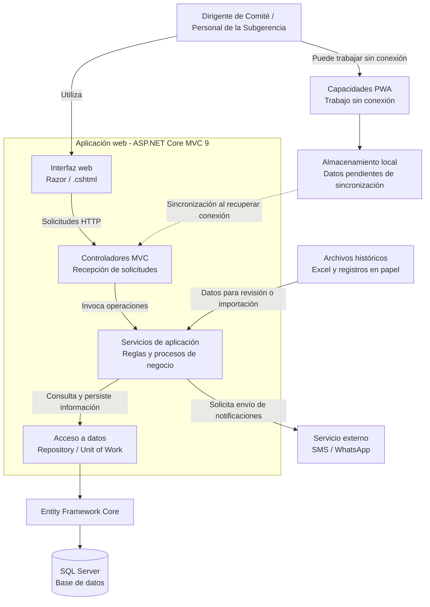

# C2 - Diagrama de Contenedores

## 1. Descripción

El diagrama de contenedores presenta la estructura técnica general del Sistema de Gestión de Programas Sociales de Huamanga.

La solución se plantea como una aplicación web desarrollada con ASP.NET Core MVC 9, utilizando C# para la lógica de aplicación, Razor para las vistas, Entity Framework Core para el acceso a datos y SQL Server para el almacenamiento persistente.

También se contempla el uso de capacidades PWA para facilitar el trabajo sin conexión y la sincronización de información cuando se recupere la conectividad.

## 2. Diagrama

## 3. Descripción de los contenedores y elementos

- **Interfaz web:** presenta formularios, listados y reportes a los usuarios mediante vistas Razor.
- **Controladores MVC:** reciben las solicitudes y coordinan las operaciones de la aplicación.
- **Servicios de aplicación:** concentran las reglas de negocio, como el registro de beneficiarios, la validación de posibles duplicados y la generación de reportes.
- **Acceso a datos:** organiza las consultas y operaciones de persistencia mediante los patrones Repository y Unit of Work descritos en la arquitectura.
- **Entity Framework Core:** permite interactuar con la base de datos desde C#.
- **SQL Server:** almacena la información persistente del sistema.
- **Capacidades PWA y almacenamiento local:** apoyan el trabajo sin conexión y el mantenimiento de operaciones pendientes hasta recuperar la conectividad.
- **Servicio SMS / WhatsApp:** representa la integración externa prevista para el envío de notificaciones.
- **Archivos históricos:** representan las fuentes de información que pueden revisarse o importarse durante la migración.

## 4. Consideraciones técnicas

La aplicación se organiza como un monolito modular: sus funcionalidades se separan por responsabilidades, pero forman parte de una misma aplicación.

El almacenamiento local, la sincronización y la integración con mensajería deben implementarse de acuerdo con los mecanismos definidos en el proyecto. El diagrama representa la arquitectura documentada y no confirma por sí solo que todas estas funciones ya estén implementadas.
