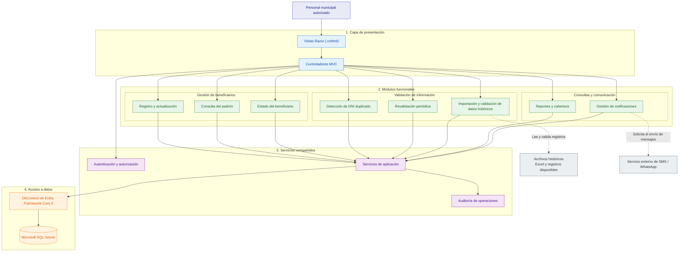

# C3. Diagrama de componentes

## 1. Objetivo

El diagrama de componentes representa la organización interna de la aplicación web del Sistema de Gestión de Programas Sociales de Huamanga. Se muestran los componentes de presentación, los módulos funcionales, los servicios compartidos y el acceso a datos.

La solución utiliza una arquitectura de monolito modular desarrollada con ASP.NET Core MVC 9, Entity Framework Core 9 y Microsoft SQL Server.

Este diagrama es una propuesta arquitectónica. Los componentes representados deberán validarse durante el desarrollo del sistema.

## 2. Diagrama de componentes

## 3. Descripción de los componentes

| Componente | Responsabilidad |
|---|---|
| Controladores MVC | Reciben las solicitudes del usuario y coordinan las operaciones de la aplicación. |
| Vistas Razor | Presentan formularios, tablas, mensajes y resultados en la interfaz web. |
| Registro y actualización | Gestiona el registro y la modificación de los datos de los beneficiarios. |
| Consulta del padrón | Permite consultar los beneficiarios registrados. |
| Estado del beneficiario | Gestiona los estados definidos para los beneficiarios según las reglas del sistema. |
| Detección de DNI duplicado | Comprueba si un documento de identidad ya se encuentra registrado y permite advertir posibles duplicados. |
| Revalidación periódica | Apoya la revisión periódica de la información de los beneficiarios. |
| Importación y validación de datos históricos | Permite preparar, validar e importar información procedente de archivos existentes. |
| Reportes y cobertura | Organiza consultas, reportes y datos destinados a visualizar la cobertura de los programas sociales. |
| Gestión de notificaciones | Coordina las solicitudes de notificación a través de una integración externa que deberá definirse. |
| Autenticación y autorización | Gestiona el acceso y los permisos según el rol del usuario. |
| Auditoría de operaciones | Registra las operaciones relevantes para facilitar su seguimiento. |
| Servicios de aplicación | Coordinan las reglas y operaciones compartidas por los módulos. |
| DbContext de Entity Framework Core 9 | Gestiona las consultas y operaciones de persistencia hacia Microsoft SQL Server. |
| Microsoft SQL Server | Almacena los datos persistentes del sistema. |

## 4. Organización modular

Los componentes funcionales se agrupan en tres áreas principales:

### 4.1. Gestión de beneficiarios

Comprende el registro y actualización, la consulta del padrón y la gestión del estado de los beneficiarios.

### 4.2. Validación de información

Agrupa la detección de documentos duplicados, la revalidación periódica y la importación de datos históricos. Su objetivo es contribuir a la calidad y consistencia de la información.

### 4.3. Consultas y comunicación

Incluye la generación de reportes, la información de cobertura y la coordinación de notificaciones mediante servicios externos.

Los servicios de autenticación, auditoría y aplicación son compartidos por los módulos cuando corresponda.

## 5. Tecnologías y decisiones arquitectónicas

- **Framework web:** ASP.NET Core MVC 9.
- **Lenguaje:** C# sobre .NET 9.
- **Interfaz:** Razor, HTML5, CSS3 y Bootstrap.
- **Acceso a datos:** Entity Framework Core 9.
- **Base de datos:** Microsoft SQL Server.
- **Estilo arquitectónico:** monolito modular.
- **Repository y Unit of Work:** no se presentan como componentes obligatorios; su conveniencia deberá evaluarse durante la implementación.
- **Integración de mensajería:** SMS o WhatsApp están considerados como una posibilidad, pero el proveedor aún debe definirse.
- **Integraciones institucionales:** RENIEC y SISFOH no se consideran dependencias de la primera versión.

## 6. Consideraciones

1. Los módulos forman parte de una misma aplicación; no representan microservicios independientes.
2. La detección de DNI duplicado debe coordinarse con las reglas de negocio para gestionar coincidencias y advertencias.
3. Las operaciones importantes deberán registrar los datos de auditoría que se definan en los requisitos.
4. La importación de información histórica deberá validar los registros antes de incorporarlos al padrón.
5. Las capacidades de uso sin conexión y sincronización se describen en el diagrama de contenedores C2. Su implementación deberá contemplar la resolución de conflictos y la protección de los datos locales.
6. Los componentes de este diagrama son conceptuales y deberán ajustarse a las clases, servicios y módulos que se desarrollen realmente.
