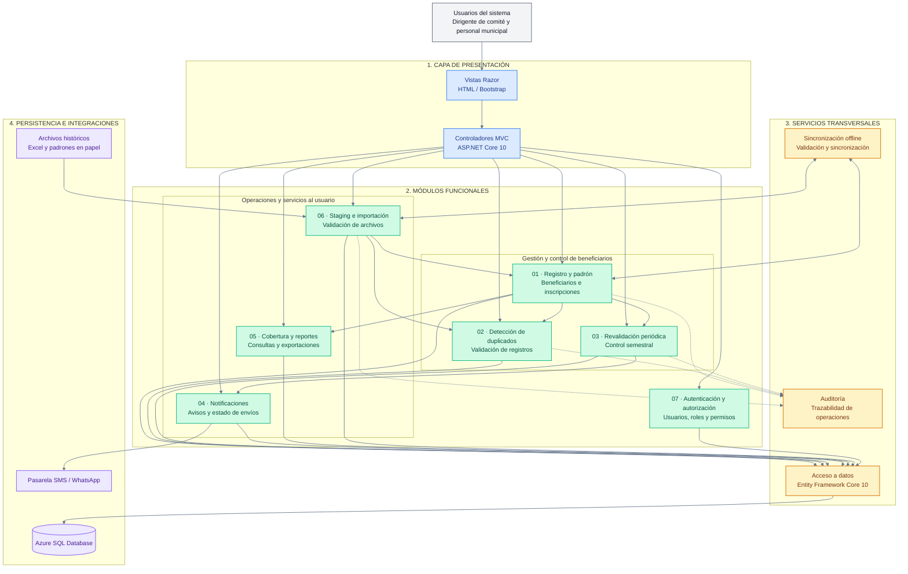

# C4 — Nivel 3: Diagrama de Componentes

## Sistema de Gestión de Programas Sociales de Huamanga

Este diagrama representa los principales componentes de la arquitectura propuesta, sus responsabilidades y sus relaciones. El sistema se organiza mediante ASP.NET Core MVC, módulos funcionales, servicios transversales y persistencia de datos.

## Responsabilidad de los módulos

| N.º | Módulo | Responsabilidad |
|---|---|---|
| 01 | Registro y padrón | Gestionar beneficiarios e inscripciones. |
| 02 | Detección de duplicados | Identificar posibles duplicados según las reglas del programa y comité. |
| 03 | Revalidación periódica | Controlar el proceso de revalidación semestral. |
| 04 | Notificaciones | Coordinar avisos y registrar el estado de los envíos. |
| 05 | Cobertura y reportes | Consultar cobertura y generar reportes autorizados. |
| 06 | Staging e importación | Recibir y validar archivos antes de incorporar los datos. |
| 07 | Autenticación y autorización | Gestionar el acceso mediante usuarios, roles y permisos. |

**Nota arquitectónica:** el diagrama representa el diseño propuesto. Las integraciones, la sincronización offline y los servicios deberán implementarse y validarse durante el desarrollo.
