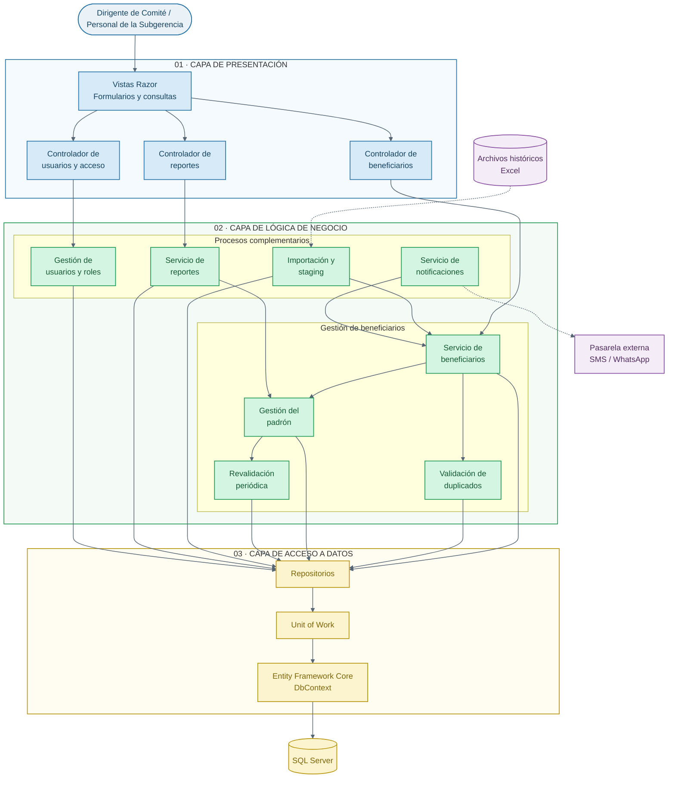

# C3 — Diagrama de Componentes

**Proyecto:** Sistema de Gestión de Programas Sociales de Huamanga  
**Modelo:** C4 — Nivel 3: Componentes  
**Propósito:** Detallar las responsabilidades internas de la aplicación.

## Diagrama de componentes

## Descripción

La capa de presentación recibe las solicitudes de los usuarios. La capa de negocio agrupa las operaciones de beneficiarios, validación de duplicados, padrón, revalidación, importación, notificaciones, reportes y administración de usuarios. La capa de acceso a datos organiza la persistencia mediante repositorios, Unit of Work y Entity Framework Core.

La separación facilita el mantenimiento y permite identificar las responsabilidades de cada parte del sistema.

**Nota:** los componentes son una organización conceptual basada en los requisitos y la arquitectura documentada. Se deben contrastar con el código fuente para confirmar sus nombres y relaciones reales.
