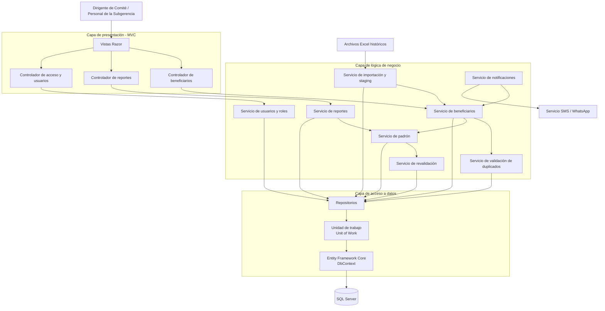

# C3 - Diagrama de Componentes

## 1. Descripción

El diagrama de componentes presenta las principales responsabilidades internas de la aplicación. Se basa en la arquitectura MVC y en la separación de la lógica de negocio, el acceso a datos y la presentación.

Los componentes se organizan para facilitar el mantenimiento y evitar que las reglas del sistema se concentren directamente en las vistas o en los controladores.

## 2. Diagrama

## 3. Descripción de los componentes

- **Vistas Razor:** permiten ingresar y consultar la información del sistema.
- **Controlador de beneficiarios:** coordina las solicitudes relacionadas con el registro, la actualización y la inactivación de beneficiarios.
- **Controlador de reportes:** gestiona las solicitudes para consultar y exportar información.
- **Controlador de acceso y usuarios:** coordina el acceso al sistema y la administración de usuarios y roles.
- **Servicio de beneficiarios:** aplica las reglas de registro y actualización de beneficiarios.
- **Servicio de validación de duplicados:** verifica posibles coincidencias, especialmente mediante el DNI.
- **Servicio de padrón:** organiza las operaciones relacionadas con los beneficiarios inscritos.
- **Servicio de revalidación:** contempla la revisión periódica de los datos de los beneficiarios.
- **Servicio de importación y staging:** permite preparar y revisar información procedente de archivos históricos.
- **Servicio de notificaciones:** coordina el envío de mensajes a través del servicio externo.
- **Servicio de reportes:** prepara información sobre cobertura y distribución de beneficiarios.
- **Servicio de usuarios y roles:** contempla la administración de usuarios y permisos.
- **Repositorios y Unit of Work:** organizan las operaciones de acceso y persistencia de información.
- **Entity Framework Core:** conecta la lógica de acceso a datos con SQL Server.

## 4. Relación con los requisitos funcionales

Los componentes apoyan los requisitos de registro y actualización de beneficiarios, validación de DNI, control de duplicados, auditoría, revalidación, notificaciones, reportes, importación de archivos históricos, gestión de usuarios y sincronización.

## 5. Consideración

Los nombres utilizados son descriptivos y representan una propuesta de organización. Antes de presentar este diagrama como una descripción exacta de la implementación, se deben contrastar sus componentes con los controladores, servicios y repositorios existentes en el código fuente.
