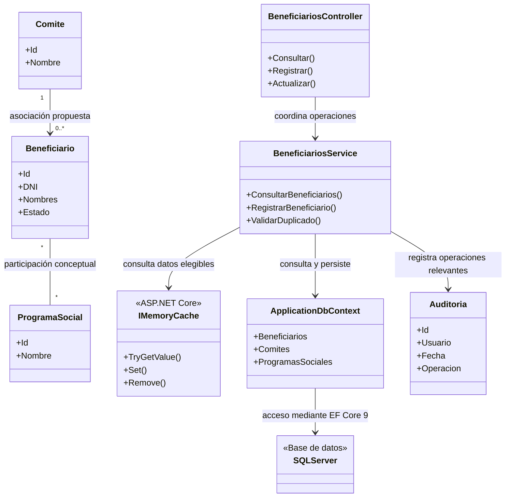

# C4. Vista de código (UML conceptual)

## 1. Objetivo

Esta vista presenta una propuesta de organización de las clases principales del Sistema de Gestión de Programas Sociales de Huamanga. Complementa los diagramas C1, C2 y C3 mediante ejemplos de entidades del dominio, controladores, servicios y acceso a datos.

La solución propuesta utiliza C# sobre .NET 9, ASP.NET Core MVC 9, Entity Framework Core 9 y Microsoft SQL Server.

**Importante:** las clases, propiedades, métodos y relaciones mostrados son conceptuales. Deberán ajustarse cuando se desarrolle y valide el código fuente del sistema.

## 2. Diagrama UML de clases

## Comportamiento del caché en el código

La estrategia propuesta incorpora `IMemoryCache` en la capa de aplicación para reducir consultas repetidas a la base de datos cuando se solicitan datos de lectura frecuente.

El servicio de aplicación comprobará primero si la información solicitada está disponible en el caché. Si existe una entrada válida, podrá devolverla directamente. Si no existe, obtendrá los datos a través del contexto de datos y Entity Framework Core 9, que se comunica con Microsoft SQL Server.

Después de recuperar los datos, el servicio podrá almacenarlos temporalmente para solicitudes posteriores. Las entradas deberán tener un tiempo de expiración definido y deberán invalidarse o actualizarse cuando se modifique la información relacionada.

No todas las consultas deben utilizar caché. Las operaciones de escritura y los datos personales sensibles requieren un tratamiento cuidadoso para evitar inconsistencias o la exposición de información.

Este comportamiento representa el diseño previsto. La implementación de las clases, la configuración del caché y las pruebas de rendimiento se realizarán posteriormente.

**Criterio de uso:** el caché se propone para datos de lectura frecuente y no sensibles, como catálogos de programas sociales. No se utilizará indiscriminadamente para consultas de duplicidad, operaciones de escritura ni información personal sensible. Las entradas deberán tener una expiración definida y actualizarse o invalidarse cuando cambien los datos relacionados. Los nombres y métodos del diagrama son ilustrativos y deberán adaptarse al código que se implemente realmente.

## 3. Descripción de las clases

| Clase | Responsabilidad |
|---|---|
| Beneficiario | Representa a una persona registrada en el sistema. |
| Comite | Representa un comité asociado a la gestión de beneficiarios. |
| ProgramaSocial | Representa un programa social administrado por el sistema. |
| Auditoria | Representa información de seguimiento de operaciones relevantes. |
| BeneficiarioController | Atiende las solicitudes relacionadas con la gestión de beneficiarios desde la interfaz MVC. |
| BeneficiarioService | Agrupa las operaciones y reglas de negocio relacionadas con los beneficiarios. |
| ApplicationDbContext | Define el acceso de Entity Framework Core a las entidades y a la base de datos. |
| SQLServer | Representa el motor de base de datos Microsoft SQL Server. |

## 4. Relaciones del modelo

1. El controlador de beneficiarios coordina las operaciones mediante el servicio de aplicación.
2. El servicio consulta y persiste la información utilizando `ApplicationDbContext`.
3. `ApplicationDbContext` utiliza Entity Framework Core 9 para acceder a Microsoft SQL Server.
4. El modelo propone que un beneficiario esté asociado a un comité. Esta relación deberá confirmarse con las reglas reales del negocio.
5. La participación de un beneficiario en uno o varios programas sociales se representa como una relación conceptual. En la implementación podría requerir una entidad intermedia para registrar fechas, estado y otros datos de participación.
6. Las operaciones relevantes pueden generar registros de auditoría conforme a los requisitos de seguridad y trazabilidad.

## 5. Tecnologías relacionadas

- **Lenguaje:** C#.
- **Plataforma:** .NET 9.
- **Framework web:** ASP.NET Core MVC 9.
- **Acceso a datos:** Entity Framework Core 9.
- **Base de datos:** Microsoft SQL Server.
- **Organización:** monolito modular.

## 6. Consideraciones de implementación

- Los nombres y métodos son ilustrativos; no implican que las clases ya existan en el repositorio.
- Los controladores deben limitarse a gestionar solicitudes y coordinar los servicios, evitando concentrar toda la lógica de negocio.
- Las reglas de duplicidad del DNI deberán definirse y validarse antes de implementarse.
- Las relaciones entre beneficiarios, comités y programas sociales deberán verificarse con los requisitos funcionales.
- El registro de auditoría deberá definir qué operaciones registrar, qué datos conservar y quién puede consultar el historial.
- El acceso a datos se representa mediante Entity Framework Core 9; no se impone el uso de Repository o Unit of Work.
- Microsoft SQL Server es la base de datos seleccionada. No se presupone que esté alojada en Azure.

## 7. Alcance de esta vista

Este diagrama es una representación conceptual del código propuesto, no una descripción de clases verificadas en una implementación existente. Cuando se desarrolle el sistema, deberá actualizarse para reflejar las clases, interfaces, propiedades y relaciones reales.
