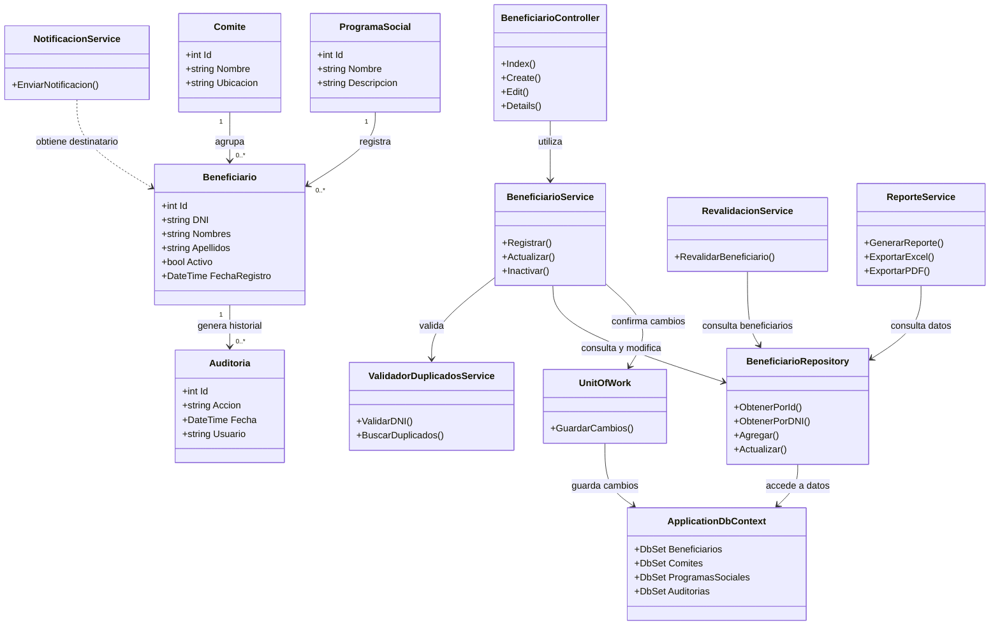

# C4 - Diagrama de Código

## 1. Descripción

El diagrama de código representa, mediante clases y relaciones, una posible organización interna del Sistema de Gestión de Programas Sociales.

Se consideran clases relacionadas con los beneficiarios, los comités, los programas sociales, la auditoría, los servicios de negocio y el acceso a datos.

Este diagrama es conceptual. Los nombres, atributos, métodos y relaciones deben verificarse y ajustarse según el código fuente real del sistema.

## 2. Diagrama de clases

## 3. Descripción de las clases

- **Beneficiario:** representa a una persona registrada en un programa social.
- **Comite:** representa al comité relacionado con la gestión de beneficiarios.
- **ProgramaSocial:** identifica el programa social correspondiente.
- **Auditoria:** representa los registros históricos de las operaciones realizadas.
- **BeneficiarioController:** recibe las solicitudes relacionadas con los beneficiarios.
- **BeneficiarioService:** concentra las operaciones principales del negocio.
- **ValidadorDuplicadosService:** contempla la validación de DNI y la búsqueda de posibles duplicados.
- **RevalidacionService:** representa las operaciones de revalidación de beneficiarios.
- **NotificacionService:** coordina las notificaciones.
- **ReporteService:** prepara reportes y operaciones de exportación.
- **BeneficiarioRepository:** representa el acceso a los datos de beneficiarios.
- **UnitOfWork:** representa la coordinación de los cambios que se guardan en la base de datos.
- **ApplicationDbContext:** representa el contexto de Entity Framework Core.

## 4. Relación con la arquitectura

El diagrama sigue una separación de responsabilidades:

1. El controlador recibe las solicitudes de la interfaz.
2. El servicio aplica las reglas de negocio.
3. Los repositorios permiten consultar y modificar información.
4. Entity Framework Core gestiona la comunicación con la base de datos.
5. Las entidades representan los datos principales del dominio.

## 5. Consideraciones

Este diagrama no garantiza que las clases indicadas existan actualmente en el repositorio. Antes de considerarlo el nivel de código definitivo, se deben revisar los archivos `.cs` y sustituir los nombres, atributos, métodos y relaciones por los que realmente estén implementados.

Los métodos del controlador también son ilustrativos y no representan firmas completas de ASP.NET Core MVC.
