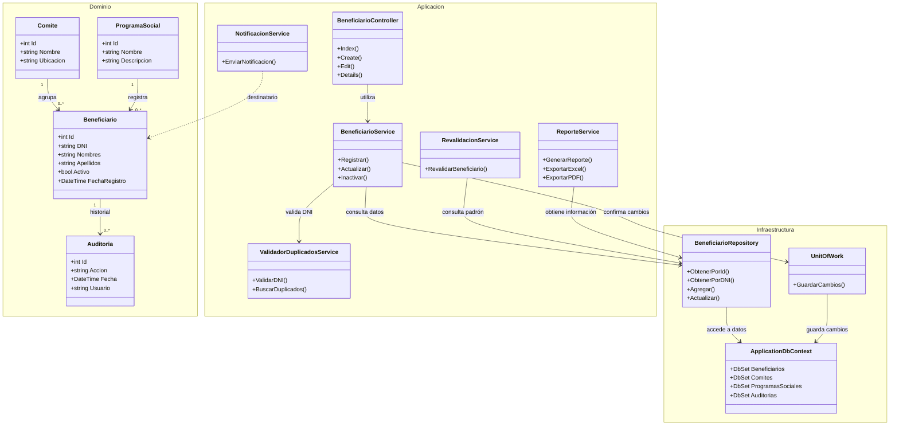

# C4 — Diagrama de Código

**Proyecto:** Sistema de Gestión de Programas Sociales de Huamanga  
**Modelo:** C4 — Nivel 4: Código  
**Propósito:** Representar las clases conceptuales y sus relaciones.

## Diagrama UML de clases

## Descripción

El modelo divide las clases en tres grupos conceptuales:

- **Dominio:** contiene las entidades principales del negocio, como beneficiarios, comités, programas sociales y auditoría.
- **Aplicación:** representa los controladores y servicios que coordinan las operaciones del sistema.
- **Infraestructura:** representa el acceso a datos mediante repositorios, Unit of Work y Entity Framework Core.

Las relaciones muestran cómo los controladores utilizan servicios, los servicios acceden a los repositorios y los elementos de persistencia interactúan con el contexto de base de datos.

## Consideración importante

Los nombres, atributos, métodos y relaciones de este diagrama son ilustrativos. Antes de presentar el nivel C4 como una representación exacta del código, deben verificarse los archivos `.cs` del repositorio y ajustarse las clases a la implementación real.
