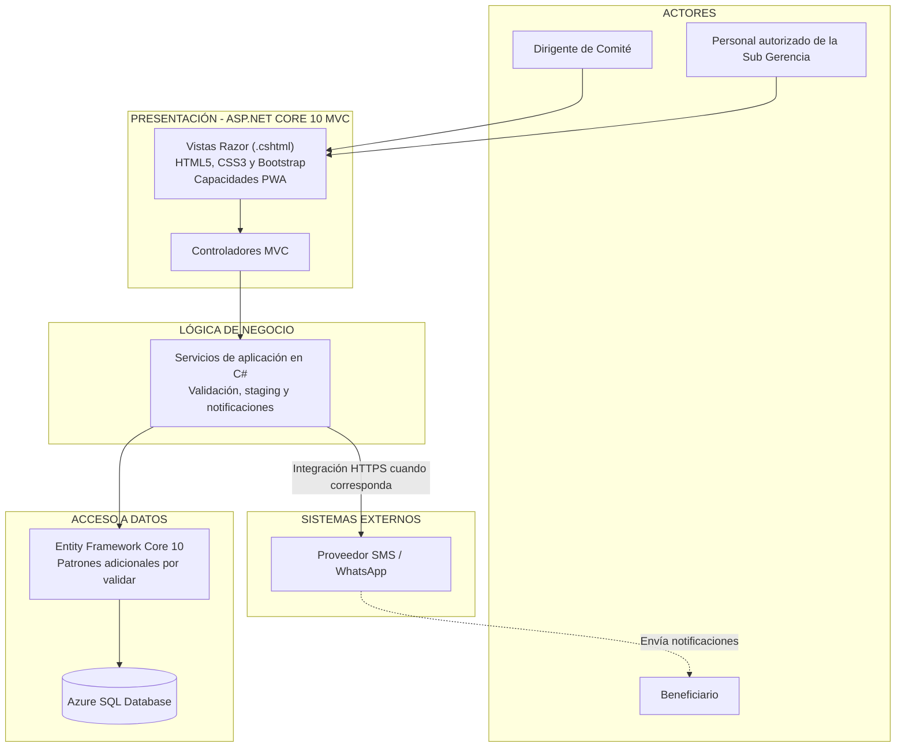
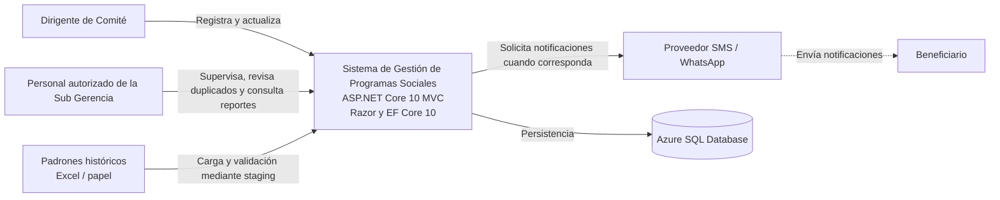

# Arquitectura inicial del sistema

## Diagrama de arquitectura

## Descripción

La arquitectura inicial se organiza en tres capas lógicas siguiendo el patrón MVC sobre ASP.NET Core 9:

-   **Presentación (Capa MVC - Web):** Permite la interacción de los usuarios mediante Vistas Razor (`.cshtml`). Para los dirigentes en zonas de baja conectividad, las vistas incorporan capacidades de PWA (Progressive Web App) para soporte offline-first. Los Controladores orquestan las peticiones HTTP.
-   **Lógica de Negocio (Servicios):** Contiene las clases de servicio responsables de las funcionalidades core: autenticación, registro, staging, validación de duplicados, revalidación, cobertura y notificaciones. Todo desarrollado en C#.
-   **Datos (Infraestructura):** Almacena y consulta la información utilizando Entity Framework Core junto con los patrones Unit of Work y Repository, apuntando a una base de datos SQL Server (`AuditoriaDB`).

Además, la capa de negocio se integra con sistemas externos: el servicio de **Notificaciones** con el **gateway SMS/WhatsApp** y el servicio de **Staging** con la carga inicial desde el **padrón histórico** de cada comité.

## Asignación de requisitos a módulos (Servicios MVC)

| Módulo (Servicio) | Requisitos | Responsabilidad |
| :--- | :--- | :--- |
| Autenticación | RF-12, RF-13, RNF-04 | Valida credenciales de dirigentes y personal municipal mediante ASP.NET Core Identity y controla accesos por roles. |
| Registro y Padrón | RF-01, RF-03, RF-05, RF-14 | Registra y actualiza beneficiarios por comité mediante Unit of Work; mantiene el historial de cambios. |
| Detección de Duplicados | RF-02, RF-04 | Verifica en la base de datos si el DNI ya existe en otro comité y alerta a la Sub Gerencia. |
| Revalidación Periódica | RF-06 | Controla la lógica para solicitar la revalidación de cada beneficiario cada 6 meses. |
| Notificaciones | RF-07 | Genera y encola las notificaciones hacia el gateway externo (SMS/WhatsApp). |
| Cobertura y Reportes | RF-08, RF-09, RF-10 | Ejecuta consultas LINQ complejas para calcular beneficiarios activos por zona y exportar el padrón. |
| Staging | RF-11 | Limpia, valida y estructura la carga masiva inicial de Excel/CSV antes de consolidarla mediante EF Core. |

## Reglas de dependencia

-   **Flujo estricto:** Las Vistas (Presentación) interactúan con los Controladores. Los Controladores llaman a los Servicios de Negocio. Los Servicios acceden a Datos a través del Unit of Work. Nunca se accede a la base de datos desde la Vista o el Controlador.
-   **Inyección de Dependencias:** Los servicios de negocio, repositorios y el Unit of Work se configuran mediante el contenedor de Inyección de Dependencias nativo de .NET 9 (`Program.cs`), garantizando el bajo acoplamiento.
-   **Integraciones externas:** Los sistemas externos (SMS/WhatsApp) se consumen mediante `HttpClient` desde la capa de Servicios de Negocio, nunca desde la presentación.

## Justificaciones de diseño

-   **Staging separado del Registro y Padrón (DA07):** Los datos históricos de Excel llegan con errores y duplicados. Si se cargaran directo mediante el DbContext principal, contaminarían el padrón real o lanzarían excepciones de EF Core. El staging permite sanearlos en memoria o en tablas temporales antes de un `SaveChanges()`.
-   **Patrón Unit of Work (DA03):** Se utiliza para garantizar que las operaciones complejas (ej. registrar un beneficiario, inscribirlo a un programa y crear el registro de auditoría) se ejecuten en una única transacción de SQL Server, manteniendo la integridad referencial.
-   **Desarrollo Orientado a Especificaciones (SDD):** Centralizar la lógica en la capa de Servicios facilita la validación de las reglas de negocio (ej. unicidad de DNI) mediante pruebas unitarias, alineándose con la metodología Spec-Driven Development.

- **Staging separado del Registro y Padrón (DA07):** los datos históricos de Excel y papel llegan con errores y duplicados. Si se cargaran directo, contaminarían el padrón real. El staging permite validarlos y limpiarlos antes de consolidarlos.
- **Base de datos aislada (DA03):** contiene datos personales sensibles. Solo el servidor de aplicaciones puede acceder a ella, lo que reduce la superficie de ataque.

## Vista de contexto

Esta vista muestra el sistema como una caja negra: solo aparecen sus actores y los sistemas con los que se comunica. El diagrama de arquitectura, en cambio, muestra su estructura interna por capas y módulos.
