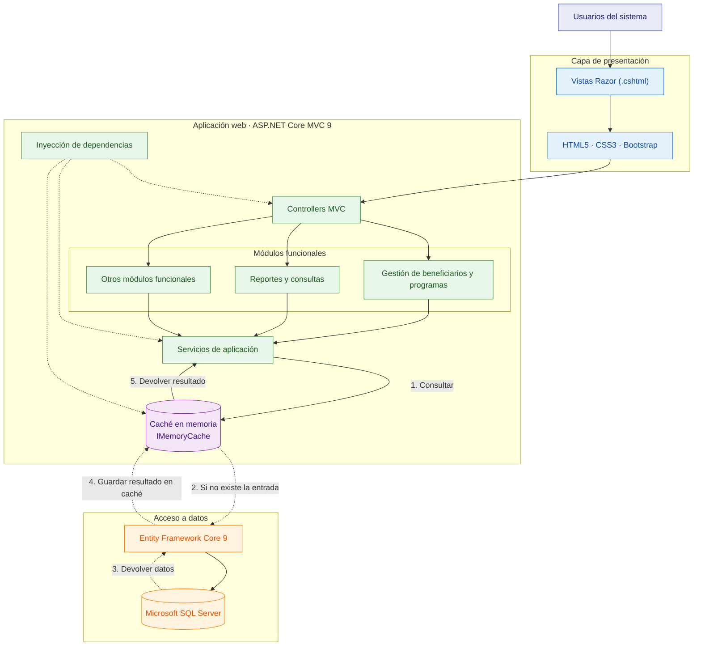

# Enfoque arquitectónico del sistema

## 1. Introducción

El Sistema de Gestión de Programas Sociales de Huamanga se plantea como una aplicación web destinada a apoyar al personal municipal en el registro, consulta, validación y seguimiento de la información de los beneficiarios de los programas sociales.

La arquitectura propuesta busca organizar las funcionalidades del sistema, facilitar su mantenimiento y permitir que la información se gestione de manera consistente. También considera las dificultades de conectividad que pueden presentarse durante el trabajo de campo.

La documentación describe una propuesta arquitectónica académica. Las decisiones y funcionalidades deberán validarse durante el desarrollo del sistema.

## 2. Enfoque arquitectónico seleccionado

Se propone una arquitectura de **monolito modular**, organizada mediante el patrón MVC (Modelo-Vista-Controlador).

El monolito modular permite mantener las funcionalidades dentro de una misma aplicación, separándolas en módulos con responsabilidades definidas. Este enfoque resulta apropiado para el alcance del proyecto porque permite organizar el sistema sin introducir la complejidad operativa de una arquitectura de microservicios.

El patrón MVC permite separar la presentación de las solicitudes y de la lógica de aplicación, favoreciendo una estructura más clara.

### Diagrama general del enfoque MVC

## 3. Tecnologías propuestas

| Elemento | Tecnología | Uso previsto |
|---|---|---|
| Lenguaje | C# | Desarrollo de la lógica de la aplicación. |
| Plataforma | .NET 9 | Ejecución de la aplicación. |
| Framework web | ASP.NET Core MVC 9 | Gestión de solicitudes y organización MVC. |
| Presentación | Razor, HTML5, CSS3 y Bootstrap | Construcción de la interfaz web. |
| Acceso a datos | Entity Framework Core 9 | Consultas y persistencia de información. |
| Base de datos | Microsoft SQL Server | Almacenamiento persistente. |
| Caché en memoria | IMemoryCache de ASP.NET Core | Conservar temporalmente resultados de consultas frecuentes para reducir accesos repetidos a la base de datos. |
| Diagramas | Mermaid | Documentación visual de la arquitectura. |

Las versiones de las tecnologías se mantienen alineadas con las restricciones y el `README.md` del proyecto.

## 4. Organización de la solución

La aplicación se organiza en las siguientes áreas:

### 4.1. Presentación

Incluye los controladores MVC y las vistas Razor que permiten al personal municipal interactuar con el sistema.

### 4.2. Módulos funcionales

Los módulos propuestos son:

- **Gestión de beneficiarios:** registro, actualización y consulta del padrón.
- **Detección de duplicados:** validación de documentos de identidad y advertencias de posibles coincidencias.
- **Revalidación periódica:** apoyo a la revisión de la información de los beneficiarios.
- **Importación de datos históricos:** preparación, validación e incorporación de registros existentes.
- **Reportes y cobertura:** consulta de información y generación de reportes.
- **Notificaciones:** coordinación de avisos mediante servicios externos, cuando se definan e integren.

### 4.3. Servicios compartidos

Incluyen las funciones comunes que puedan requerir los módulos, como autenticación, autorización, auditoría y coordinación de operaciones.

#### Estrategia de caché en memoria

Se propone incorporar `IMemoryCache`, proporcionado por ASP.NET Core, como mecanismo de almacenamiento temporal de datos consultados con frecuencia. El objetivo es reducir las consultas repetidas a Microsoft SQL Server y mejorar los tiempos de respuesta de las operaciones de lectura.

El funcionamiento previsto será el siguiente:

1. El servicio de aplicación solicita los datos al caché.
2. Si existe una entrada válida, se devuelve el resultado almacenado.
3. Si no existe una entrada válida, se consulta la información mediante Entity Framework Core 9 y Microsoft SQL Server.
4. El resultado obtenido se almacena temporalmente en el caché y se devuelve al servicio solicitante.
5. Las entradas tendrán un tiempo de expiración definido y deberán invalidarse o actualizarse cuando cambien los datos relacionados.

Como primera aplicación, se propone evaluar el almacenamiento temporal de catálogos de programas sociales y otros datos de consulta frecuente que no contengan información personal sensible.

Esta estrategia es una decisión arquitectónica propuesta y deberá implementarse y validarse mediante pruebas de rendimiento. El caché en memoria del servidor es independiente del almacenamiento local que se contempla para las capacidades PWA sin conexión.

### 4.4. Acceso a datos

Se propone utilizar Entity Framework Core 9 para gestionar las operaciones de persistencia sobre Microsoft SQL Server.

El uso de Repository y Unit of Work no se establece como obligatorio. Su conveniencia se evaluará durante la implementación, evitando introducir abstracciones innecesarias.

## 5. Funcionamiento sin conexión

Debido a las posibles limitaciones de conectividad, se contempla evaluar capacidades PWA y almacenamiento local para permitir determinadas operaciones sin conexión.

Esta capacidad no implica que toda la aplicación funcione automáticamente sin Internet. Será necesario definir:

- Qué operaciones estarán disponibles sin conexión.
- Qué datos podrán almacenarse localmente.
- Cómo se protegerá la información almacenada en el dispositivo.
- Cómo se sincronizarán los registros pendientes.
- Cómo se resolverán los conflictos y los errores de sincronización.
- Cómo se verificará que la información se haya guardado correctamente en el servidor.

La viabilidad de estas capacidades deberá validarse mediante pruebas.

## 6. Integraciones externas

Se consideran posibles integraciones con servicios de SMS o WhatsApp para el envío de notificaciones a los beneficiarios. La selección del proveedor y los mecanismos de integración están pendientes de definición.

Los archivos históricos, como hojas de cálculo y registros existentes, se consideran fuentes potenciales para la importación y validación de información.

RENIEC y SISFOH no se consideran dependencias confirmadas de la primera versión.

## 7. Justificación del enfoque

La elección del monolito modular se fundamenta en los siguientes aspectos:

1. **Simplicidad:** concentra el despliegue en una aplicación y reduce la complejidad operativa inicial.
2. **Organización:** separa las funcionalidades por responsabilidades.
3. **Mantenibilidad:** facilita la identificación de las áreas que deben modificarse.
4. **Consistencia de datos:** permite coordinar las operaciones de negocio y persistencia dentro de una misma aplicación.
5. **Evolución:** permite revisar los módulos y ampliar sus funcionalidades según las necesidades del proyecto.
6. **Adecuación al alcance:** evita introducir infraestructura distribuida sin una necesidad demostrada.

## 8. Relación con el modelo C4

La propuesta se documenta mediante los siguientes diagramas:

- **C1 — Contexto:** presenta el sistema, sus usuarios y las entidades externas.
- **C2 — Contenedores:** representa el cliente web, la aplicación, el acceso a datos y las integraciones previstas.
- **C3 — Componentes:** muestra los módulos funcionales y los servicios compartidos.
- **Vista de código UML conceptual:** presenta clases y relaciones propuestas para ilustrar la organización interna.

Los diagramas se encuentran en el directorio `arquitectura/C4/`.

## 9. Consideraciones finales

El enfoque arquitectónico proporciona una base para organizar el desarrollo del Sistema de Gestión de Programas Sociales de Huamanga. Su validez dependerá de que las decisiones propuestas se contrasten con los requisitos funcionales, los atributos de calidad y las restricciones documentadas.

Las tecnologías, las integraciones y las capacidades sin conexión deberán comprobarse durante la implementación. La documentación debe actualizarse si cambian las decisiones técnicas o las necesidades del sistema.
