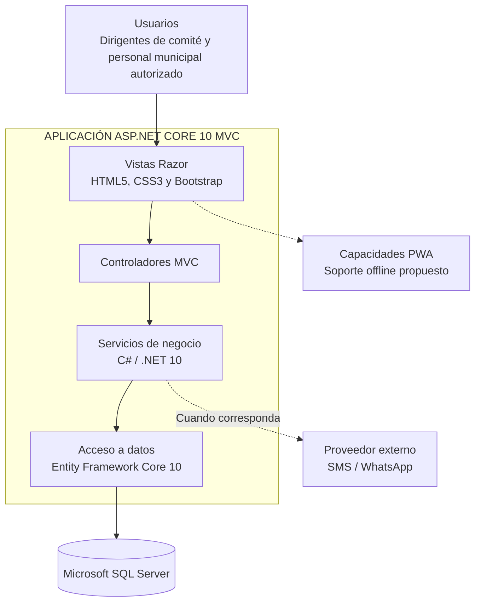

# Enfoque Arquitectónico

## 1. Introducción

El Sistema de Gestión de Programas Sociales de Huamanga se plantea mediante un enfoque de arquitectura basado en ASP.NET Core MVC y un monolito modular. El objetivo es organizar las funcionalidades del sistema de manera clara, facilitar el mantenimiento y mantener una solución adecuada para el alcance del proyecto académico.

## 2. Enfoque seleccionado

Se propone utilizar el patrón Modelo-Vista-Controlador (MVC), proporcionado por ASP.NET Core.

- **Modelo:** representa los datos y las reglas relacionadas con las entidades del sistema.
- **Vista:** presenta la información al usuario mediante vistas Razor (`.cshtml`).
- **Controlador:** recibe las solicitudes, coordina las operaciones y devuelve las vistas o respuestas correspondientes.

La organización modular permitirá separar las responsabilidades relacionadas con beneficiarios, programas sociales, comités, validaciones, reportes y auditoría.

### Diagrama general del enfoque MVC

## 3. Tecnologías

| Elemento | Tecnología prevista |
|---|---|
| Lenguaje | C# |
| Framework web | ASP.NET Core 9 |
| Patrón de presentación | MVC |
| Vistas | Razor (`.cshtml`) |
| Estilos | HTML5, CSS3 y Bootstrap |
| Acceso a datos | Entity Framework Core 9 |
| Base de datos | Microsoft SQL Server |
| Organización | Monolito modular |

### Patrones de persistencia propuestos

Se contempla evaluar los patrones Repository y Unit of Work para organizar el acceso a los datos y coordinar las operaciones de persistencia. Sin embargo, su incorporación definitiva queda pendiente de validación durante la implementación, de acuerdo con las necesidades reales del sistema.

Entity Framework Core proporciona mecanismos de seguimiento de entidades y coordinación de cambios mediante `DbContext`. Por ello, no se considera obligatorio implementar clases adicionales de Repository o Unit of Work si no existe una necesidad concreta que justifique su uso.

La decisión final deberá considerar la complejidad del acceso a datos, la separación de responsabilidades, la facilidad de mantenimiento y la posibilidad de realizar pruebas. La documentación se actualizará cuando la implementación permita confirmar los patrones utilizados.

## 5. Justificación

El enfoque seleccionado permite:

- Mantener una tecnología coherente con el README principal.
- Separar responsabilidades sin distribuir innecesariamente el sistema en varios servicios.
- Facilitar la incorporación progresiva de módulos.
- Reutilizar los mecanismos de configuración e inyección de dependencias de ASP.NET Core.
- Integrar el acceso a datos mediante Entity Framework Core y SQL Server.

## 6. Consideraciones

Las capacidades PWA y el funcionamiento sin conexión se consideran objetivos de diseño que deberán validarse mediante la implementación. Del mismo modo, cualquier integración externa, como SMS o WhatsApp, dependerá de la configuración del proveedor correspondiente.

La documentación describe la arquitectura prevista y no implica que todas sus funcionalidades se encuentren implementadas.
