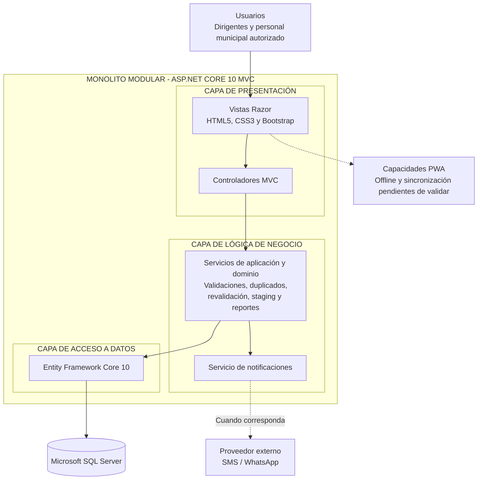

# Estilo Arquitectónico

## 1. Estilo seleccionado

El Sistema de Gestión de Programas Sociales de Huamanga utilizará como estilo principal un **monolito modular**, organizado mediante el patrón MVC de ASP.NET Core.

En este enfoque, los módulos se organizan dentro de una aplicación principal y comparten la infraestructura necesaria para su funcionamiento. La separación por módulos busca mantener responsabilidades claras y facilitar el mantenimiento.

## 2. Características principales

- Una aplicación principal desplegable como una unidad.
- Separación funcional en módulos.
- Uso de MVC para organizar la presentación y el procesamiento de solicitudes.
- Acceso a datos mediante Entity Framework Core 9.
- Persistencia en Microsoft SQL Server.
- Uso de inyección de dependencias para gestionar los servicios.

## 3. Organización por capas

| Capa | Responsabilidad |
|---|---|
| Presentación | Vistas Razor, controladores y comunicación con el usuario. |
| Aplicación | Coordinación de casos de uso y servicios del sistema. |
| Dominio | Entidades y reglas de negocio. |
| Infraestructura | Persistencia, Entity Framework Core y comunicación con servicios externos. |

Esta organización representa una separación lógica de responsabilidades. No significa que necesariamente existan cuatro proyectos físicos independientes.

## 4. Módulos funcionales previstos

1. Gestión de usuarios y acceso.
2. Registro y actualización de beneficiarios.
3. Gestión de comités y programas sociales.
4. Validación de registros duplicados.
5. Revalidación periódica de beneficiarios.
6. Reportes y cobertura.
7. Importación y depuración de datos.
8. Auditoría de operaciones.

Los módulos definitivos deberán ajustarse al alcance funcional y a la implementación del proyecto.

## 5. Diagrama del estilo arquitectónico

La solución utiliza una arquitectura en capas organizada como monolito modular. La presentación, la lógica de negocio y el acceso a datos forman parte de la aplicación ASP.NET Core 10 MVC.

**Descripción:** las vistas presentan la interfaz, los controladores coordinan las solicitudes, los servicios aplican las reglas del negocio y Entity Framework Core 10 permite acceder a Microsoft SQL Server. Las notificaciones se gestionan mediante un servicio de la aplicación y un proveedor externo. Las capacidades offline quedan sujetas a implementación y pruebas.

## 6. Ventajas

- Menor complejidad de despliegue que una solución distribuida en múltiples servicios.
- Organización de las funcionalidades por responsabilidades.
- Facilidad para compartir componentes y servicios.
- Adecuación para un proyecto que necesita evolucionar progresivamente.
- Posibilidad de mantener una estructura clara sin introducir complejidad innecesaria.

## 7. Consideraciones

El monolito modular no implica que todas las funcionalidades estén terminadas. La PWA, la sincronización sin conexión y las integraciones externas deberán verificarse durante el desarrollo.

La arquitectura se considera una propuesta documentada y deberá contrastarse con el código fuente cuando la implementación esté disponible.
