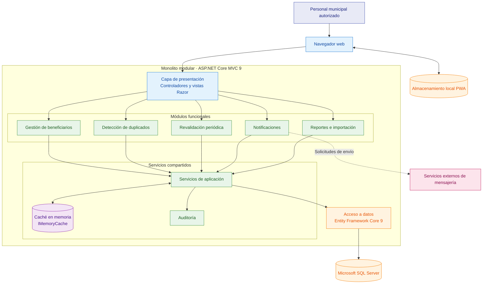

# Estilo arquitectónico del sistema

## 1. Introducción

El Sistema de Gestión de Programas Sociales de Huamanga se plantea como una aplicación web que permite gestionar información de beneficiarios, validar registros, consultar el padrón y generar reportes para el personal municipal autorizado.

Para organizar la solución se propone un estilo de **monolito modular**, utilizando el patrón arquitectónico MVC (Modelo-Vista-Controlador) para estructurar la interacción entre los usuarios y la aplicación.

Este documento describe la organización arquitectónica propuesta. La implementación y validación técnica están pendientes.

## 2. Estilo arquitectónico seleccionado: monolito modular

El monolito modular consiste en una aplicación que se despliega como una unidad, pero que organiza sus funcionalidades en módulos con responsabilidades diferenciadas.

Para este proyecto, los módulos funcionales se agrupan en:

- Gestión de beneficiarios.
- Detección de duplicados.
- Revalidación periódica.
- Importación y validación de datos históricos.
- Reportes y cobertura.
- Gestión de notificaciones.
- Servicios compartidos de autenticación, autorización y auditoría.

Esta organización permite separar las responsabilidades del sistema sin tener que implementar y desplegar cada módulo como un servicio independiente.

### 2.1. Justificación

Se propone este estilo por las siguientes razones:

1. Reduce la complejidad inicial de despliegue y administración.
2. Facilita la organización de las funcionalidades por módulos.
3. Permite centralizar las operaciones de persistencia en una aplicación.
4. Favorece el mantenimiento y la evolución gradual del sistema.
5. Se ajusta al alcance académico y a las necesidades identificadas en los requisitos.

## 3. Patrón MVC

El patrón Modelo-Vista-Controlador organiza la aplicación en tres responsabilidades principales.

| Elemento | Responsabilidad |
|---|---|
| Modelo | Representa los datos y conceptos del dominio que utiliza el sistema. |
| Vista | Presenta la información y los formularios mediante Razor (`.cshtml`). |
| Controlador | Recibe las solicitudes, coordina las operaciones y devuelve las respuestas correspondientes. |

La lógica de negocio se organizará en servicios de aplicación cuando sea necesario, evitando concentrar todas las reglas en los controladores.

## 4. Tecnologías propuestas

| Elemento | Tecnología |
|---|---|
| Lenguaje | C# |
| Plataforma | .NET 9 |
| Framework web | ASP.NET Core MVC 9 |
| Interfaz | Razor, HTML5, CSS3 y Bootstrap |
| Acceso a datos | Entity Framework Core 9 |
| Base de datos | Microsoft SQL Server |
| Diagramas | Mermaid |

Las tecnologías y versiones deben mantenerse alineadas con el `README.md` y con el archivo `analisis-de-sistema/05-restricciones.md`.

## 5. Organización lógica de la arquitectura

La solución se organiza en cuatro áreas lógicas:

### 5.1. Presentación

Contiene los controladores MVC y las vistas Razor que permiten al personal municipal interactuar con la aplicación.

### 5.2. Módulos funcionales

Agrupa las funcionalidades de registro y consulta de beneficiarios, validación de duplicados, revalidación, importación de datos, reportes y notificaciones.

### 5.3. Servicios compartidos

Incluye las funciones que pueden utilizar distintos módulos, como autenticación, autorización, auditoría y coordinación de operaciones.

### 5.4. Acceso a datos

Utiliza Entity Framework Core 9 para realizar las operaciones de consulta y persistencia sobre Microsoft SQL Server.

Los patrones Repository y Unit of Work no se consideran obligatorios en esta propuesta. Su uso deberá evaluarse cuando exista una implementación concreta y se pueda justificar su beneficio.

## Estrategia de caché en memoria

El sistema mantiene un enfoque de monolito modular: los módulos funcionales forman parte de una única aplicación y comparten servicios internos. Dentro de esta estructura, se propone utilizar `IMemoryCache` de ASP.NET Core para almacenar temporalmente resultados de consultas frecuentes.

El caché no constituye un microservicio ni una base de datos independiente. Se ejecuta dentro del proceso de la aplicación web y puede reducir las consultas repetidas a Microsoft SQL Server cuando la información solicitada está disponible y vigente.

Para mantener la coherencia de los datos, se deberán definir tiempos de expiración e invalidar o actualizar las entradas relacionadas cuando se realicen modificaciones. Se priorizarán catálogos y datos de consulta frecuente que no contengan información personal sensible.

Esta estrategia es distinta del almacenamiento local previsto para las capacidades PWA: `IMemoryCache` funciona en el servidor, mientras que el almacenamiento local permite conservar determinados datos en el navegador.

La estrategia está propuesta a nivel arquitectónico y deberá implementarse y validarse mediante pruebas antes de afirmar que produce mejoras de rendimiento.

## 6. Diagrama del estilo arquitectónico




## 7. Consideraciones de conectividad

El sistema contempla evaluar capacidades PWA para apoyar determinadas operaciones cuando no exista conexión a Internet.

El uso sin conexión requiere definir qué operaciones estarán disponibles, cómo se almacenarán los datos localmente, cómo se sincronizarán y cómo se resolverán los conflictos. Estas capacidades deberán implementarse y probarse antes de considerarse disponibles.

## 8. Integraciones externas

Se contempla la posibilidad de integrar un servicio de SMS o WhatsApp para enviar notificaciones a los beneficiarios. La elección del proveedor y los detalles de integración quedan pendientes.

Los archivos históricos pueden utilizarse como fuente para importar y validar información. RENIEC y SISFOH no se consideran integraciones confirmadas de la primera versión.

## 9. Relación con el modelo C4

La organización del sistema se complementa con los diagramas del directorio `arquitectura/C4/`:

- C1 representa el contexto del sistema.
- C2 representa sus contenedores.
- C3 representa sus componentes internos.
- La vista UML conceptual presenta ejemplos de clases y relaciones.

Los diagramas deben ser coherentes entre sí y con los requisitos funcionales, los atributos de calidad y las restricciones del proyecto.

## 10. Conclusión

El monolito modular con MVC permite organizar el sistema en responsabilidades claras y mantener una solución de complejidad controlada. La separación entre presentación, módulos funcionales, servicios compartidos y persistencia proporciona una base para el desarrollo y mantenimiento.

La arquitectura descrita es una propuesta que deberá contrastarse con la implementación, las pruebas y las decisiones técnicas definitivas.
```

## Verificación

Después de pegarlo y guardar con `Ctrl + S`:

- Comprueba que no haya referencias a `.NET 10`, `ASP.NET Core 10` o `EF Core 10`.
- Verifica que el diagrama se visualice correctamente en la vista previa de Markdown.
- Confirma que el estilo siga siendo **monolito modular con MVC**, no microservicios.

El siguiente paso será revisar los documentos de análisis para asegurarnos de que las tecnologías y las decisiones arquitectónicas coincidan con los requisitos. Así podremos terminar las correcciones antes de realizar el único commit.